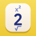
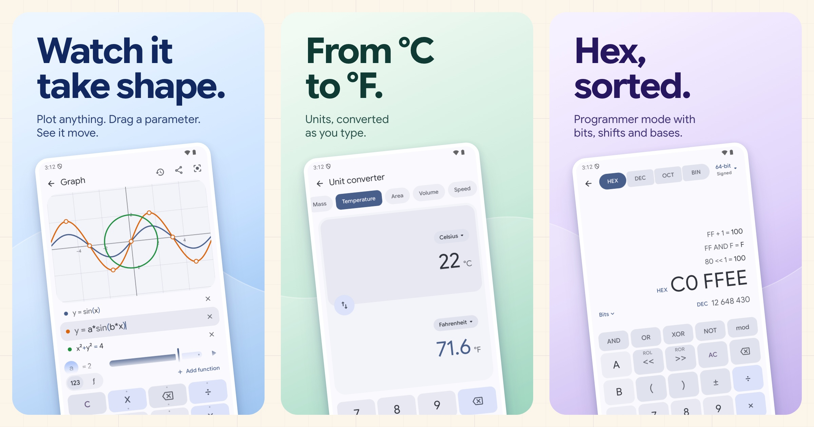
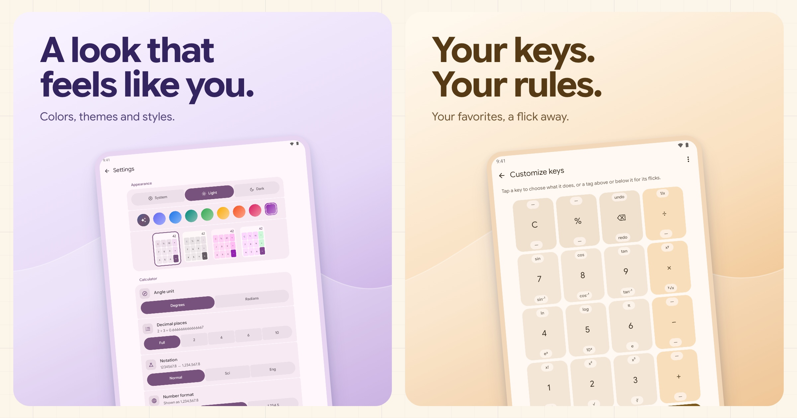
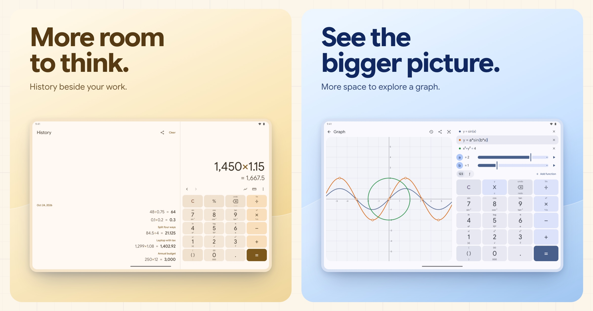
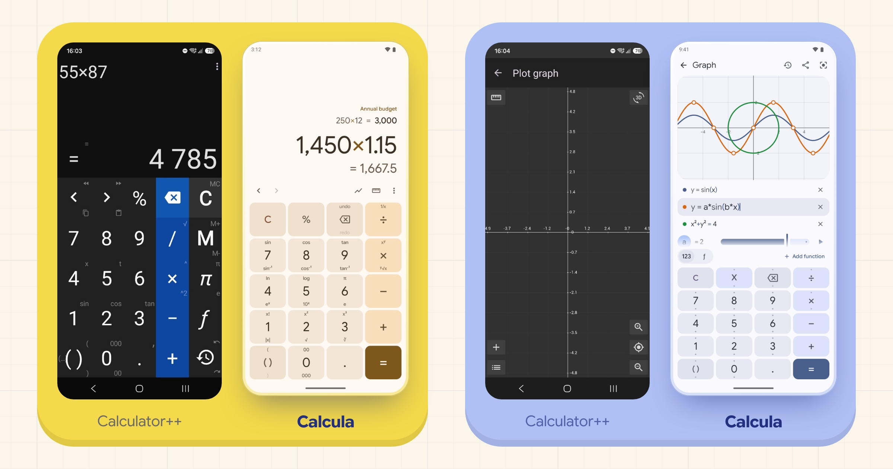

  

<h1 align="center">Calcula</h1>

<strong>Flick a key. Get a function.</strong>

A calculator for Android, iOS, and the web. The keypad you know, with scientific functions a flick away, answers that update as you type, and a history you can pick up again.

  

  
  &nbsp;&nbsp;
  

## Everything under your thumb

  

- **Functions on the keys.** Flick up for the function written above a key, down for its partner. Trigonometry, logs, roots, powers, π and more, with no second screen of buttons.
- **Exact answers.** Decimal arithmetic keeps `0.1 + 0.2` at `0.3`. Percentages work the way you expect: `200 + 10%` gives `220`. Simple fractions appear beside decimal results.
- **Room to correct yourself.** Move the cursor, select part of an expression, wrap it in a function, or undo. Past calculations can be reused, edited, and given a note.
- **Tools when you need them.** Graph functions and equations, convert units, work in any number base, or summarize a list of values.

## Make it yours

  

Choose light or dark, your wallpaper's colors or a color family, and a style you can preview before applying. Keep the function labels, switch to small dots, or hide the hints, and drag the bar above the keys to resize them. When you want more, assign your own key shortcuts, save named memories, define functions such as `tip(x) = x × 0.18`, or switch to reverse Polish notation.

## On a bigger screen

History gets its own pane on tablets and foldables, keeping previous calculations in view beside your current work.

  

## A few gestures

- **Flick up or down** on a key for its scientific functions. Hold it to reveal both.
- **Tap the answer preview** to accept it, just like pressing equals.
- **Double-tap the expression** to select, then apply a function or parentheses to that selection.
- **Flick backspace up or down** to undo or redo.

## From Calculator++ to Calcula

The same phone, before and after: the keypad keeps its flick-for-a-function idea, and the plotter now draws as you type.

  

Calcula grows out of [Calculator++](https://github.com/serso/android-calculatorpp), Sergey Solovyev's swipe-key calculator. That idea lives on in a new implementation built with Kotlin Multiplatform and Compose.

## Private by design

No ads, accounts, or tracking. Calculations run on your device. Read the [Privacy Policy](PRIVACY.md) for local storage, optional sharing, backups, and deletion controls.

Building from source or contributing? See [docs/DEVELOPMENT.md](docs/DEVELOPMENT.md).
