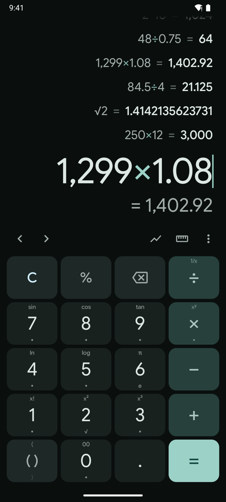
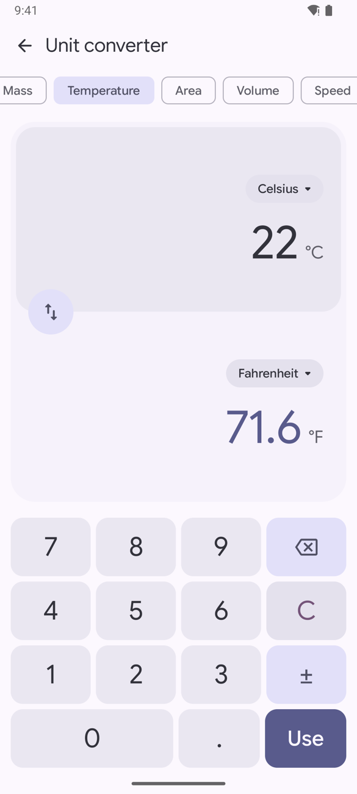
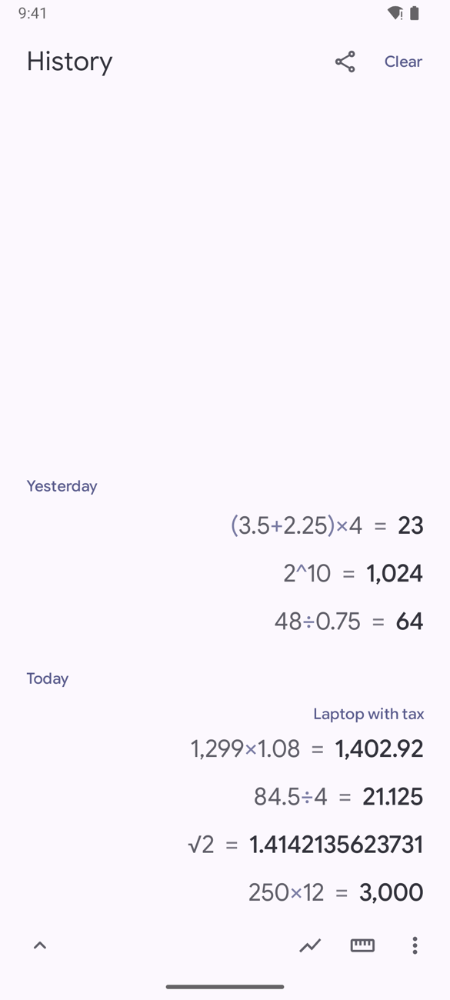
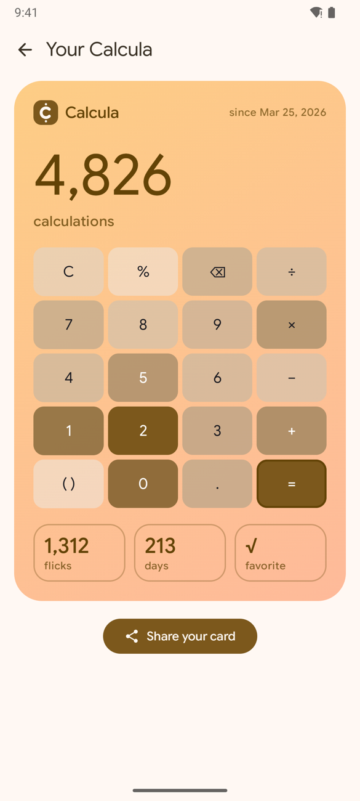
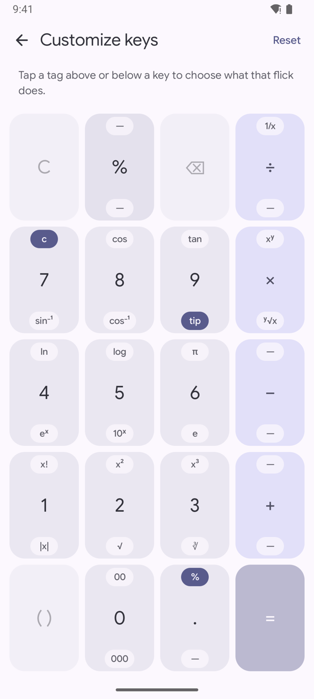
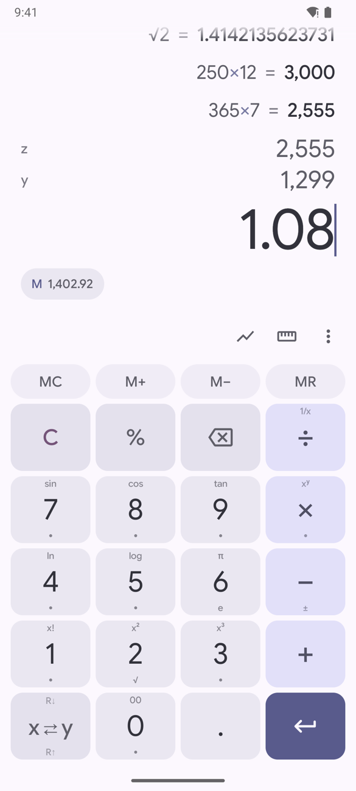
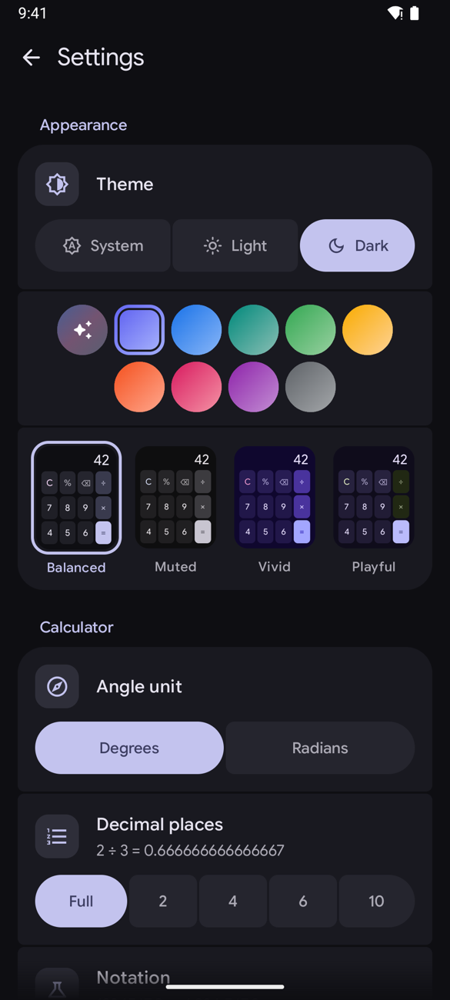
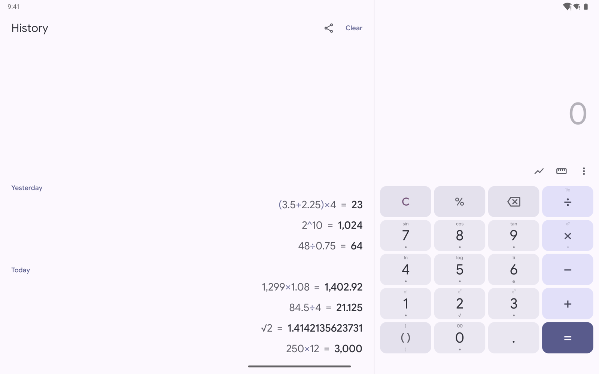
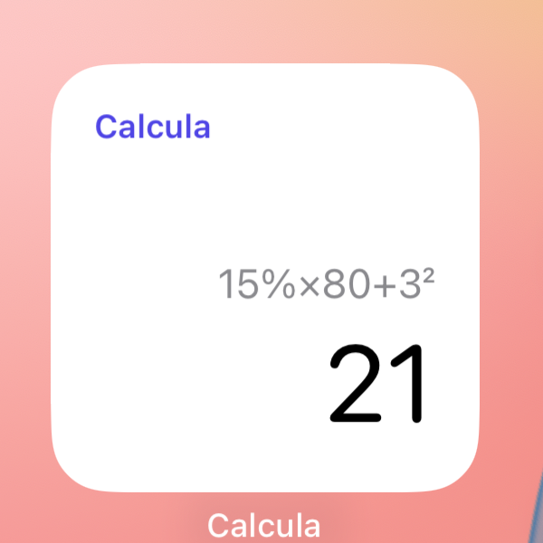

<p align="center">
  
</p>

<h1 align="center">Calcula</h1>

<p align="center"><b>Flick a key. Get a function.</b></p>

<p align="center">
  A calm, exact calculator for Android, iOS and the web. Every digit carries more: flick up for sin, log, x², π; flick down for their partners.<br>
  The functions are named right on the keys, so there's no second screen of buttons and nothing to dig for.
</p>

<p align="center">
  
  &nbsp;&nbsp;
  
</p>

<p align="center">
  <a href="https://github.com/bernaferrari/android-calculatorpp/releases"><b>Download</b></a>
</p>

## Why people like it

- **Functions under your thumb.** sin, cos, tan, ln, log, π, x², √ and more live on the digits. Each key names the function a flick up gives you; hold it to see both. Reach for one that can't apply yet and the key shakes its head.
- **Exact answers.** 0.1 + 0.2 is 0.3, not 0.30000000000000004. Smart percent: 200 + 10% is 220. When a result is a simple fraction it says so too: 0.375 is also 3/8.
- **A keypad you already know.** 0 under 2 like a phone's dial pad, backspace up top by the operators, parentheses in the corner. Tap the preview (= 52) to take it, like pressing =.
- **A history you'll actually use.** Past results stay above the keys. Tap one to reuse it, pull the bar down to see them all, add a note to any of them, share the lot as text.
- **Edits like text.** Double-tap to select, then wrap it in parentheses or √ with one key. Drag along the expression, or use ‹ ›, to move the cursor. Flick ⌫ up to undo, down to redo.
- **Hints that stay your way.** Function names stay on the keys until you choose otherwise. Prefer small dots or nothing at all? Change the hint style in Settings.
- **Yours to shape.** Light or dark, ten color families or your wallpaper's, each in four styles you preview as the keypad itself. Drag the bar above the keys to make them bigger or smaller.

## Beyond the keypad

| Graph | Convert | Remember |
| :---: | :---: | :---: |
|  |  |  |
| Up to six functions and equations, sliders for a, b, c, d, roots and turns you can tap. Graphs are kept and share as images. | Length, mass, temperature, data and more, with exact factors. The number on screen comes along, and the answer goes back. | Every calculation by day. Notes on the ones that matter, and the whole list shares as text. |

## Your Calcula



A card of how you calculate: your keypad lit up where your thumb goes most, how many calculations, flicks and days, and the function you reach for most. It fills in as you use the app, follows your colors, and shares as an image in one tap.

<br clear="right">

## Once you know your way around

Prefer less to read? Choose two small dots per key in Settings: the same flicks, quieter hints. When you want every function in view, **ƒ** turns the digits into them for one press, or hold it to keep them; the ones that would do nothing yet are dimmed.

<p align="center">
  
</p>

## For the ones who want more

Everything here is off by default or tucked in the ⋮ menu, so the calculator stays simple until you go looking.

| Library | Your own keys | Programmer |
| :---: | :---: | :---: |
|  |  |  |
| 28 constants of science (c, h, Nₐ, G…), functions you write yourself, and named memories. | Every key and every flick, = and ⌫ included, can do anything: another key, a function, a constant, one of yours, or nothing. Layouts export and import as text. | Hex, decimal, octal and binary, bitwise operators and shifts, 8 to 64 bits, every bit tappable, and a tape of what you worked out. |

| RPN and memory | Statistics | Styles |
| :---: | :---: | :---: |
|  |  |  |
| Reverse Polish entry with an open-ended stack, and MC · M+ · M− · MR in a slim row. | Type a list, get mean, median, σ and s, min and max. Tap any to use it. | Color families and four styles, each shown as the keypad it gives you. |

And a few more:

- **Write your own functions.** `tip(x) = x×0.18`, then type `tip(` like `sin(`. They work in previews, in RPN and in the graph, and they can call each other.
- **Scientific and engineering notation.** 1.23×10⁶ or 12.3×10³, with the decimals you choose.
- **Siri and Shortcuts on iOS.** "Calculate with Calcula", then say it the way you'd say it: "15% of 80 plus 3 squared". The answer is spoken back and kept in your history.

## Big screens and home screens

<p align="center">
  
  &nbsp;&nbsp;
  
</p>

On tablets and foldables your history gets its own pane beside the keys. On the home screen there's a widget: the whole calculator on Android, your latest answer on iOS.

## Private by design

No ads, no accounts, no tracking. Calculations are processed on your device; the app does not send them to us.

Read the [Privacy Policy](PRIVACY.md) for local storage, optional sharing, Android backups, and deletion controls.

## Where it comes from

Calcula grows out of [Calculator++](https://github.com/serso/android-calculatorpp), the swipe-key calculator Sergey Solovyev started in 2011. Its best idea, that a key can hold more than one thing, is still at the heart of it; everything else is rebuilt from scratch in Kotlin Multiplatform and Compose, for Android, iOS and the web.

Found a bug or have an idea? [Open an issue](https://github.com/bernaferrari/android-calculatorpp/issues).

## Build and develop

The running app is Kotlin Multiplatform: `shared/` contains the domain logic and Compose UI,
`androidApp/` is the Android host, `iosApp/` is the Xcode host, and `webApp/` is the Wasm host.
The separate `web/` directory is a Next.js project, not the shared calculator runtime.

### Prerequisites

- Use the checked-in Gradle wrapper. Its daemon toolchain is JetBrains JDK 21; Android bytecode targets Java 17.
- Install the Android SDK matching `compileSdk` in `androidApp/build.gradle.kts` (currently API 37, minor API 2).
  Point `sdk.dir` in your untracked `local.properties` at that SDK, or configure `ANDROID_HOME`.
- iOS builds require macOS, Xcode, its command-line tools, and an installed iOS simulator runtime.
- Gradle provisions the Node runtime for the Wasm build. The first build needs network access for dependencies.

### Run

```bash
# Build Android; installDebug also installs onto a connected emulator/device.
./gradlew :androidApp:assembleDebug
./gradlew :androidApp:installDebug

# Run the shared Compose calculator in a browser.
./gradlew :webApp:wasmJsBrowserDevelopmentRun
```

For iOS, open `iosApp/iosApp.xcodeproj`, select the `iosApp` scheme and a simulator, then Run.
Device installation additionally requires your own signing team in Xcode.

### Validate changes

```bash
# Common tests plus JVM-only differential checks against java.math.BigDecimal.
./gradlew :shared:testAndroidHostTest

# Verify shared code compiles for the other platforms.
./gradlew :shared:compileKotlinWasmJs :shared:compileKotlinIosSimulatorArm64
```

`shared/build/reports/tests/testAndroidHostTest/index.html` contains the test report.
The suite covers expression evaluation, history delete/undo, persisted preferences, calculator
state restoration, and decimal arithmetic. Decimal differential tests use a fixed random seed
so failures are reproducible. UI checks should include large fonts, reduced motion, both flick
directions, history undo after a new calculation, and graph pan/zoom/trace/export.

Graph UI code is grouped by responsibility: `GraphScreen` coordinates layout, `GraphControls`
edits functions and parameters, `GraphCanvas` handles plot gestures, `GraphDrawing` renders the
plot and shared thumbnails/export primitives, and `GraphKeypadResize` handles resizing.
